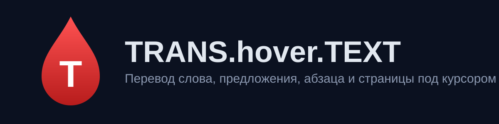

<div align="center">



# TRANS.hover.TEXT

**Перевод слова, предложения, абзаца и всей страницы под курсором — в один клавиш.**

[](LICENSE)
[](manifest.json)
[](#)

[Установка](#-установка) · [Горячие клавиши](#-горячие-клавиши) · [Настройки](#-настройки) · [Приватность](#-приватность) · [Русская версия](#ru)

</div>

---

## ✨ Что умеет

- **Перевод под курсором** — слово, предложение или абзац по нажатию клавиши. Клавиши выбираются в настройках.
- **Перевод выделения** — выделите мышкой фрагмент, наведите на него и нажмите клавишу — переведётся весь фрагмент.
- **Замена на месте или подсказка** — перевод может заменить текст на странице или показаться над словом.
- **Перевод всей страницы** — по `Alt+A` (клавишу можно поменять). Повторный вызов возвращает оригинал.
- **Кеш на время страницы** — уже переведённые фразы не отправляются повторно, пока вы на этой странице. Уход со страницы очищает кеш.
- **Провайдеры** — OpenRouter и OpenAI. Ключ вводится один раз в настройках (⚙), хранится только на этом компьютере.
- **21 эксперт** — общий, литературный, медицинский, юридический, IT, субтитры и другие. Можно включить автоопределение.

## 📦 Установка

1. Скачайте репозиторий или клонируйте его:
   ```bash
   git clone https://github.com/dobrdigital/TRANS.hover.TEXT.git
   ```
2. Откройте `chrome://extensions` и включите **Режим разработчика**.
3. Нажмите **Загрузить распакованное расширение** и выберите папку репозитория.
4. Нажмите ⚙ в попапе, выберите провайдера и вставьте ключ API.

Для другого браузера на базе Chromium (Edge, Brave, Opera, Vivaldi) соберите отдельную папку командой `node scripts/build-dist.mjs` и загрузите `dist/TRANS.hover.TEXT/` так же, как выше.

Для разработки отладочный Chrome запускается скриптом `scripts/start-chrome-debug.bat`.

## ⌨️ Горячие клавиши

| Действие | По умолчанию |
| --- | --- |
| Слово | `Control` |
| Предложение | `Control + Shift` |
| Абзац | `Control + Shift + Alt` |
| Выделенный текст | та же клавиша, что и для слова |
| Перевод всей страницы | `Alt + A` |

Клавиши для слова, предложения и абзаца выбираются в попапе и не должны совпадать. Клавиша страницы записывается нажатием в поле.

## ⚙️ Настройки

- **Модель** — список загружается у провайдера после ввода ключа. Фильтр «Бесплатные» / «Платные» работает для OpenRouter.
- **Эксперт** — ручной выбор или автоопределение.
- **Заменять текст на странице** — выкл. показывает подсказку над словом.
- **Переводить выделенный мышкой текст** — включает перевод выделения по клавише.
- **Дополнительный промпт** и **язык перевода** — добавляются к системной инструкции модели.

## 🔒 Приватность

- Ключи API хранятся в `chrome.storage.local` на этом компьютере.
- Текст отправляется только выбранному провайдеру и только в момент перевода.
- Расширению не нужны учётные записи и сервер автора.

## 🛠 Разработка

Зависимостей нет. Загрузите папку в `chrome://extensions`, после правок в `background.js` или `manifest.json` нажмите «Обновить».

Сборка папки для распространения (только файлы расширения, без тестов и документации): `node scripts/build-dist.mjs` → `dist/TRANS.hover.TEXT/`. Папка `dist/` в репозиторий не попадает.

Проверка синтаксиса: `node --check background.js cache.js content.js popup.js experts.js`

Тесты кеша: `node --test tests/cache.test.mjs`

Исходник иконки — `icons/icon.svg`. PNG для манифеста экспортируются из него в `icons/`.

Подробности архитектуры — в [CLAUDE.md](CLAUDE.md).

## 📄 Лицензия

[MIT](LICENSE)

---

<a name="ru"></a>

<details>
<summary><b>🇷🇺 Русская версия</b></summary>

## TRANS.hover.TEXT

Расширение для Chromium (Manifest V3): перевод слова, предложения, абзаца, выделенного текста и всей страницы под курсором через OpenRouter или OpenAI.

Установка, горячие клавиши и настройки описаны выше. Коротко:

1. Загрузите папку в `chrome://extensions` (режим разработчика).
2. Нажмите ⚙ в попапе, выберите провайдера, вставьте ключ.
3. Наведите курсор на слово и нажмите `Control`.

Всё, что вы видите в попапе, сохраняется автоматически после кнопки «Сохранить».

</details>

---

<div align="center">

Built with ❤ at [REAILISM.DEV](#)

</div>
